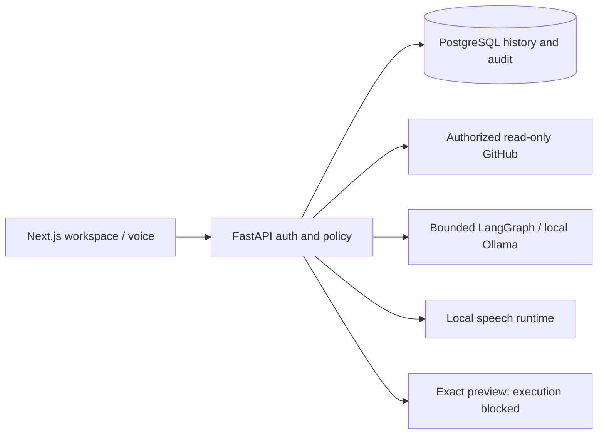

# CodeMate AI

A local-first developer assistant for investigating GitHub Actions failures,
explaining pinned source and reviewing AI patch proposals. CodeMate connects
repository evidence, local analysis and human review in one authenticated workspace.

**It proposes and reviews changes. It does not apply patches, execute sandbox
validation, create commits, push, open pull requests or deploy.** Six independent
sandbox admission requirements remain unmet; Run stays disabled.

## Capabilities

- Secure registration/login, rotating sessions, profile/settings and backend RBAC.
- Read-only GitHub App access to authorized repositories, branches, commits, pull
  requests, issues, Actions jobs and bounded redacted logs.
- Local Ollama/LangGraph investigations with structured evidence citations.
- Pinned source explanations and backend-generated reviewable patch diffs.
- Explicit approve/reject/cancel decisions, exact hashes, durable history/audits
  and non-executing validation previews.
- Typed voice commands, optional local faster-whisper/Piper speech and safe navigation.
- Sanitized correlated logs, health/readiness and ADMIN-only aggregate metrics.

AI output remains unverified interpretation. Citation validation checks source
provenance, not correctness or absence of risk. Approval records review only.

## Architecture and stack

Next.js 16.4.2, React/TypeScript, bounded Zod 4 schemas, FastAPI, SQLAlchemy/Alembic,
PostgreSQL 16, read-only GitHub App, local Ollama qwen2.5-coder:3b, LangGraph,
faster-whisper and Piper. Docker Desktop provides local PostgreSQL; it is not an
approved hostile-code execution service.



The separate trusted investigation worker processes AI analysis jobs only.
See [architecture](docs/ARCHITECTURE.md) and the
[technical case study](docs/PROJECT_OVERVIEW.md).

## Local setup: Windows PowerShell

Use Python 3.12, Node 24, Docker Desktop/PostgreSQL and installed Microsoft Edge for
browser acceptance. Preserve existing environments. Only initialize an absent venv:

```powershell
Set-Location 'D:\shyam\Projects\CodeMate-AI'
# py -3.12 -m venv backend\.venv
.\backend\.venv\Scripts\python.exe -m pip install -r backend\requirements-dev.lock.txt
.\backend\.venv\Scripts\python.exe backend\scripts\setup_local.py
powershell.exe -NoProfile -ExecutionPolicy Bypass -File infrastructure/start-postgres.ps1
Set-Location backend
.\.venv\Scripts\python.exe -m alembic upgrade head
Set-Location ..
powershell.exe -NoProfile -ExecutionPolicy Bypass -File infrastructure/start-api.ps1
```

In a separate frontend terminal:

```powershell
Set-Location 'D:\shyam\Projects\CodeMate-AI\frontend'
npm.cmd ci
npm.cmd run build
npm.cmd start -- --port 3000
```

Open http://localhost:3000. Use localhost consistently for cookie/origin behavior.
The API helper binds loopback 8000; PostgreSQL binds loopback 5433. Do not expose
PostgreSQL/Ollama/admin metrics, remove volumes or alter unrelated services.
The setup helper preserves populated secrets. The production example deliberately
contains invalid placeholders; never commit filled credentials.

Optional existing AI worker, from backend: `.\.venv\Scripts\python.exe scripts/ai_worker.py`.
Do not download models automatically. See [Windows commands](docs/WINDOWS.md),
[GitHub setup](docs/GITHUB_INTEGRATION.md), [AI diagnostics](docs/AI_DIAGNOSTICS.md)
and [deployment design](docs/DEPLOYMENT.md) for exact prerequisites and limits.

## Demonstration

Follow [DEMO_GUIDE.md](docs/DEMO_GUIDE.md): fail a controlled workflow, inspect logs
and AI evidence, explain source, request a proposal, review its exact diff, record
approval and inspect the blocked execution preview. Cancel and reload history,
then show safe typed voice navigation and operational boundaries.

`infrastructure/verify-demo.ps1` runs the controlled production-build Edge journey.
`npm.cmd run test:e2e` runs the separate owned-account auth/GitHub/AI acceptance.
Both use real application services and guarded PostgreSQL with controlled upstream
fixtures. They are not proof of real GitHub inference, physical audio or public
production deployment. Run them sequentially, with free ports 3000/8001 and no
concurrent backend suite. Screenshots remain ignored and non-sensitive.

## Testing and security

From backend, run pytest -q -W error, Ruff lint/format, pip check and Alembic
heads/current/check. From frontend, run npm test, lint, typecheck, build and both
production/full npm audits. Use only the dedicated test database/role at
127.0.0.1:5433; fixtures refuse other identities. No personal credentials, GPU,
physical microphone or privileged Docker are required for ordinary CI.

[Milestone 12 verification](docs/MILESTONE_12_VERIFICATION.md) records current
results, advisories, benchmark samples, live-service omissions and the exact future
staging allowlist. Earlier counts in historical milestone reports are not current
acceptance evidence. See [release checklist](docs/RELEASE_CHECKLIST.md).

Passwords use Argon2id; access tokens stay in memory; refresh secrets use hashed
records and HttpOnly Strict cookies with rotation/CSRF. Backend ownership/RBAC is
authoritative. Existing stateless access JWTs retain their lifetime after logout.
External data is bounded before JSON/schema validation. GitHub credentials stay
encrypted on the backend, and model output cannot grant permissions.

## Limits and future work

Local demonstration readiness is separate from public production certification.
TLS/ingress, backup/restore drills, monitoring operations, strict nonce CSP, formal
accessibility/security review and production load sizing remain incomplete.
Real-model quality and optional speech depend on local hardware and model files.
No customer adoption, production usage or unsupported performance gain is claimed.

An execution runner remains future work: dedicated hostile-code isolation,
independent image provenance, restricted worker and trusted launcher, durable
recovery, strict patch integration and real negative isolation testing. A fixture
container report cannot approve that boundary. This release adds no bypass.
