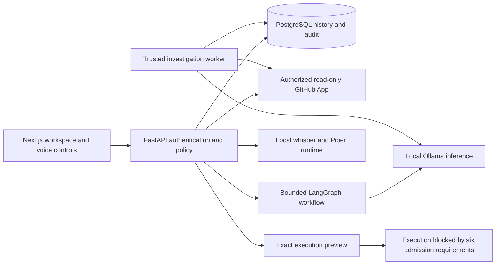

# CodeMate AI

### Understand the failure. Review the evidence. Decide what changes.

CodeMate AI is a local-first developer assistant that brings GitHub Actions logs,
repository evidence and local AI analysis into one workspace. Instead of moving
between a failed workflow, source files and a separate chat window, a developer
can investigate the failure, ask for an explanation and review a proposed fix
alongside the evidence behind it.

I built this project to explore a practical question: how can AI help developers
understand problems without giving a model unrestricted control over their code?
The answer in CodeMate is a review-first workflow with explicit permissions,
validated evidence and a clear boundary between suggesting a change and running it.

**Current release: local demonstration ready with limitations.** CodeMate can
explain code and propose patches, but it does not apply them, execute sandbox
validation, create commits, push code, open pull requests or deploy applications.

## What you can do

| Area | Supported workflow |
| --- | --- |
| Account and workspace | Register, sign in, restore a session, manage local preferences and view your profile |
| GitHub exploration | Browse authorized repositories, branches, commits, pull requests and issues through a read-only GitHub App |
| CI investigation | Inspect GitHub Actions results, failed jobs and bounded, redacted workflow logs |
| Local AI analysis | Use Ollama and LangGraph to generate structured investigations with evidence citations |
| Source explanations | Inspect a pinned source snapshot and ask for an explanation grounded in the retrieved code |
| Patch proposals | Generate a proposed correction, inspect the exact diff and record approval, rejection or cancellation |
| History and audit | Reload saved investigations, proposals, review decisions and execution preparation records |
| Execution preparation | Inspect commit and patch hashes, intended file changes and the six blocked sandbox admission requirements |
| Voice interaction | Use typed commands or optional local speech recognition and text-to-speech for supported navigation and actions |
| Operations | Check service health and database readiness, trace requests safely and retrieve ADMIN-only aggregate metrics |

AI explanations are interpretations, not verified conclusions. Citation checks
confirm that evidence came from the inspected source; they do not prove that a
suggested diagnosis or patch is correct. Human review remains part of the workflow.

## A typical developer journey

1. Sign in and connect the GitHub App to a deliberately selected repository.
2. Open a failed GitHub Actions run and inspect the relevant job logs.
3. Request an AI investigation and follow its evidence citations.
4. Inspect the related source at a pinned commit and ask for an explanation.
5. Request a patch proposal and read the backend-generated unified diff.
6. Approve, reject or cancel the proposal after reviewing its scope and risks.
7. Prepare an exact execution preview and inspect the hashes and admission blockers.
8. Reopen the saved history or use voice-assisted navigation to return to the workflow.

Approval records a review decision only. It does not modify a repository or start
validation. The Run button stays disabled, and the backend rejects execution
confirmation with `SANDBOX_UNVERIFIED`.

For a complete presentation narrative and reproducible commands, see the
[demo guide](docs/DEMO_GUIDE.md).

## Technology stack

| Layer | Technologies |
| --- | --- |
| Frontend | Next.js 16.4.2, React, TypeScript, Zod 4, TanStack Query and React Hook Form |
| Backend | FastAPI, Python 3.12, SQLAlchemy and Alembic |
| Persistence | PostgreSQL 16 |
| Repository integration | GitHub App with read-only permissions and selected installation access |
| Local AI | Ollama with qwen2.5-coder:3b and LangGraph |
| Speech | faster-whisper for transcription and Piper for speech synthesis |
| Verification | pytest, Ruff, Vitest, React Testing Library, Playwright and Microsoft Edge |
| Local infrastructure and CI | Docker Desktop, PowerShell helpers and GitHub Actions |

Model files are configured separately. The application does not download additional
models automatically to make a workflow succeed.

## How the system fits together



The investigation worker processes trusted application analysis jobs. It is not
an isolated worker for executing repository code. PostgreSQL stores the durable
state needed to reopen investigations and review records after a refresh.

More detail is available in the [architecture documentation](docs/ARCHITECTURE.md)
and the [technical case study and interview notes](docs/PROJECT_OVERVIEW.md).

## Security decisions

Security is part of the product's behavior, not just its deployment instructions.

- **Authentication:** passwords use Argon2id. Access tokens stay in browser memory;
  refresh tokens use scoped HttpOnly, SameSite=Strict cookies, hashed database
  records, rotation and CSRF protection.
- **Authorization:** the backend checks active accounts, roles and resource
  ownership. A frontend route guard does not replace API authorization.
- **GitHub access:** credentials remain encrypted on the backend. The App's
  permissions stay read-only, and repository access is checked against the
  authorized installation.
- **Untrusted data:** response-byte, nesting, collection and string limits apply
  before or during schema validation. Backend upload, source and model limits
  provide additional boundaries.
- **AI output:** retrieved content and model responses cannot grant permissions,
  authorize execution or turn a response into an unrestricted terminal command.
- **Review integrity:** pinned source, exact diffs, patch hashes, expiry checks,
  idempotency and audit records keep decisions tied to the reviewed proposal.
- **Observability:** application logs use sanitized JSON and diagnostic correlation
  IDs. Metrics are restricted to ADMIN accounts and use aggregate labels.

Some boundaries remain deliberately incomplete. Already issued stateless access
JWTs retain their configured lifetime after logout, even though refresh sessions
are revoked. Redaction and passing tests do not guarantee that every unknown
secret or vulnerability will be detected.

## Run locally on Windows

### Prerequisites

- Python 3.12 and Node.js 24.
- Docker Desktop running with the existing PostgreSQL setup available.
- Microsoft Edge for the controlled browser acceptance suite.
- Ollama and the configured model only when testing real local AI inference.
- Installed whisper and Piper models only when testing the optional speech pipeline.

The normal automated checks use controlled upstream fixtures and do not require
personal GitHub credentials, a physical microphone, a GPU or a privileged sandbox.

### Backend and database

Clone the repository if you do not already have a checkout:

```powershell
git clone https://github.com/Shyamsundar0606/CodeMate-AI.git
Set-Location CodeMate-AI
```

From the project root:

```powershell
# Create the environment only when it does not already exist.
if (-not (Test-Path backend/.venv)) {
    py -3.12 -m venv backend/.venv
}

.\backend\.venv\Scripts\python.exe -m pip install -r backend/requirements-dev.lock.txt
.\backend\.venv\Scripts\python.exe backend/scripts/setup_local.py
powershell.exe -NoProfile -ExecutionPolicy Bypass -File infrastructure/start-postgres.ps1

Set-Location backend
.\.venv\Scripts\python.exe -m alembic upgrade head
Set-Location ..

powershell.exe -NoProfile -ExecutionPolicy Bypass -File infrastructure/start-api.ps1
```

The configuration helper preserves existing populated settings. Keep real secrets
in ignored local environment files. The production example contains deliberately
invalid placeholders and must not be published with filled credentials.

### Frontend

In a separate terminal, open the checkout's `frontend` directory:

```powershell
npm.cmd ci
npm.cmd run build
npm.cmd start -- --port 3000
```

Open **http://localhost:3000**. Use `localhost` consistently for browser and API
origins so cookie and origin checks behave as configured.

The bounded API helper binds to loopback port **8000**, and PostgreSQL uses
loopback port **5433**. Keep the database, Ollama and operational metrics private.
Do not remove persistent volumes or change unrelated services during setup.

### Optional investigation worker and integrations

Start the existing investigation worker in a separate backend terminal:

```powershell
.\.venv\Scripts\python.exe scripts/ai_worker.py
```

Follow the [GitHub integration guide](docs/GITHUB_INTEGRATION.md) to configure your
own read-only App. See [AI diagnostics](docs/AI_DIAGNOSTICS.md) for local model
setup, [Windows setup](docs/WINDOWS.md) for detailed commands, and
[deployment preparation](docs/DEPLOYMENT.md) for configuration and TLS assumptions.

## Demonstration and verification

From the project root, with free ports 3000 and 8001 and no concurrent backend tests:

```powershell
powershell.exe -NoProfile -ExecutionPolicy Bypass -File infrastructure/verify-demo.ps1
```

For the separate authentication, GitHub and AI browser acceptance suite:

```powershell
Set-Location frontend
npm.cmd run test:e2e
```

Run these suites sequentially. They launch real application services against the
guarded test database, use disposable accounts and controlled GitHub/Ollama
responses, and clean their owned fixture resources. Generated screenshots and
logs stay ignored. After `test:e2e`, rebuild the normal frontend before standalone
TypeScript checks because Next.js updates its generated type references.

The Milestone 12 verification recorded:

| Check | Recorded result |
| --- | --- |
| Backend regression, warnings as errors | 562 tests passed |
| Frontend unit and component tests | 181 tests passed |
| Controlled Edge acceptance | Eight scenarios passed |
| Automation demonstration | Desktop, tablet and mobile checks passed; execution stayed disabled |
| Real local Ollama | Investigation and pinned-source proposal checks passed using controlled evidence |
| Synthetic speech | Piper synthesis, whisper transcription and safe intent interpretation passed |
| Static checks and production build | Passed |
| Dependency audits | No known findings in the recorded Python, production npm and full npm audits |

These are the results recorded for Milestone 12, not a guarantee that future
versions or advisory databases will return the same outcome. Real Ollama testing
is separate from the deterministic browser fixtures. Synthetic speech is not
physical microphone or speaker testing. Fresh live GitHub acceptance was not
performed for the final release.

See the [full verification report](docs/MILESTONE_12_VERIFICATION.md) for the
acceptance matrix, exact evidence, benchmark sample sizes and remaining limitations.

### Development checks

From `backend`:

```powershell
.\.venv\Scripts\python.exe -m pytest -q -W error
.\.venv\Scripts\python.exe -m ruff check .
.\.venv\Scripts\python.exe -m ruff format --check .
.\.venv\Scripts\python.exe -m alembic heads
.\.venv\Scripts\python.exe -m alembic current
.\.venv\Scripts\python.exe -m alembic check
.\.venv\Scripts\python.exe -m pip check
```

From `frontend`:

```powershell
npm.cmd test
npm.cmd run lint -- --max-warnings=0
npm.cmd run typecheck
npm.cmd run build
npm.cmd audit --omit=dev
npm.cmd audit
```

Database tests require the dedicated test database and role on `127.0.0.1:5433`.
Do not point them at personal or production data, and do not run database suites
concurrently. The current migration head is `0006_sandbox_previews`.

## Current limitations and future work

CodeMate is ready for a local portfolio demonstration with limitations. It is
**not certified for public production deployment**. Public TLS and ingress,
backup/restore drills, monitoring operations, strict nonce-based CSP, production
load sizing and formal accessibility/security review remain separate work.

Sandbox execution remains unavailable until all six admission requirements are
satisfied: restricted worker identity, trusted launcher separation, independently
approved image provenance, dedicated hostile-code isolation, durable execution
recovery and approved patch integration with real isolated validation.

A successful trusted Docker fixture is not independent approval of that boundary.
Local AI quality also varies with the model, input evidence and available hardware.
No autonomous repair, customer adoption, public deployment or unsupported
performance improvement is claimed.

## Project documentation

- [Demo guide](docs/DEMO_GUIDE.md): a practical presentation narrative and controlled demo commands.
- [Project overview](docs/PROJECT_OVERVIEW.md): the case study, engineering decisions, interview notes and resume material.
- [Architecture](docs/ARCHITECTURE.md): application components and trust boundaries.
- [Release checklist](docs/RELEASE_CHECKLIST.md): the checks behind a local release decision.
- [Deployment preparation](docs/DEPLOYMENT.md): service boundaries and operational limitations.
- [Verification report](docs/MILESTONE_12_VERIFICATION.md): measured results and honest acceptance status.

## About the author

**Shyamsundar Sasikumar**

MSc in Computer Security, EPITA, Paris, France

I am interested in building useful developer tools while understanding the security
tradeoffs behind them. CodeMate AI reflects that approach: local analysis, clear
evidence, human review and explicit limits on what an assistant is allowed to do.

- **Email:** [shyamsundar.sasikumar@gmail.com](mailto:shyamsundar.sasikumar@gmail.com)
- **Mobile:** [+33 7 45 60 46 71](tel:+33745604671)
- **GitHub:** [Shyamsundar0606](https://github.com/Shyamsundar0606)
