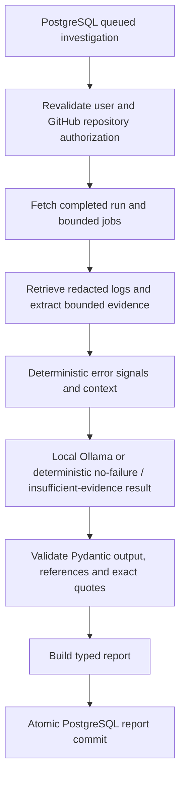

# Local AI diagnostics - Milestone 5

CodeMate diagnoses completed, authorized GitHub Actions runs through a bounded
LangGraph workflow and local Ollama. It offers hypotheses and verification advice;
it never executes suggested commands or changes a repository. Successful runs use
a deterministic metadata summary without a model request.

## Architecture



The graph has eight explicit nodes, no cycles, no model-selected tools and a
recursion limit of 12. State contains owner/connection/repository identifiers,
bounded jobs/steps, excerpts, signal IDs, safe errors, attempt and execution stage.
Full logs are not retained in graph state. PostgreSQL stores the queue, stage,
attempt count and final typed report. Recovery restarts the bounded graph from the
beginning; this is job-level recovery, not per-node checkpoint restoration.

## Local model and hardware

Selected model: `qwen2.5-coder:3b` (configurable). It was discovered locally, not
assumed or downloaded by the implementation. Observed model size: 1,929,912,626
bytes; 3.1B parameters, Q4_K_M. Local machine: approximately 16 GB RAM, 16 logical
processors, NVIDIA GeForce RTX 3050 Laptop GPU with approximately 4 GB VRAM.
Ollama endpoint reports version 0.40.3. This small coding model is a realistic
starting point; it may still make mistakes. Larger installed models were not
selected solely for their size.

Only `http://127.0.0.1:11434` is accepted. Proxies and redirects are disabled.
Cloud-tagged or remote-host models are excluded. No hosted inference fallback,
model pull, GPU requirement or paid API key is implemented. Ollama connectivity
is checked on demand and never blocks FastAPI startup.

The native `/api/chat` request uses a Pydantic JSON schema, temperature 0,
8,192-token context and 1,600-token output limit. Every output is independently
validated. JSON truncation, invalid schema, oversize responses and unsupported
references produce persisted safe failure states. HTTP responses are bounded to
128 KiB. The default local inference timeout is 120 seconds; each investigation
has a 240-second deadline checked between graph stages and during response reads.
A blocking network read is still subject to the configured HTTP timeout.

LangGraph dependencies include LangChain core and LangSmith transitively. Cloud
tracing is disabled in the local graph and callbacks are empty. No LangSmith
client, tracing export or hosted model is invoked. No prompts or full provider
responses are logged. Recheck tracing/security if extending this graph.

## Evidence and grounding

GitHub's existing service checks installation membership and repository access,
then reads run/jobs and the separate authorized job-log endpoint. Its HTTPS signed
redirect allowlist, token-free download, timeouts, 256 KiB and 4,000-line caps and
redaction are preserved.

Default investigation limits: four jobs from the first bounded page, 64,000 log
characters inspected per job, 3,000 excerpt characters per job, 12,000 total
evidence characters and 24 evidence records. Serialized context is independently
limited to 24,000 characters. Failed job/step metadata is prioritized within that
page. Additional pages/jobs are marked partial rather than silently assumed
analyzed. Missing/deleted logs yield metadata-only, uncertain reports.

Extraction detects assertions, exceptions, test/compiler/npm/lint/migration/
network/permission/time/resource errors, keeps surrounding lines, deduplicates
repeated excerpts and assigns stable IDs. Line ranges refer to the retrieved,
redacted text; redaction can alter the original artifact's line layout. Step names
are failed-step metadata, not a proven mapping of every log line to that step.
Timestamps are nullable when not reliably attributable.

Each finding supplies exact quotes with real evidence IDs. Unknown references or
invented quotes are rejected. Recognizable unsupported file/error/CVE details are
flagged with LOW confidence. Security categories require relevant evidence. This
is syntactic grounding, not a proof that every natural-language explanation is
correct. The UI separates quoted observations, hypotheses, suggested changes,
verification and limitations. Confidence is qualitative, never a probability.

## Threat model and privacy

Logs, workflow metadata and model output are untrusted. Trusted system instructions
and evidence JSON are separate messages. Log instructions such as 'ignore previous
instructions' cannot select tools, endpoints or write operations. The model has no
tools, shell, GitHub write capability or credential access. Suspicious generated
credential-disclosure or external-destination instructions are rejected.

Known GitHub/credential patterns and known session credentials are redacted before
local inference; generated output is also pattern-redacted. Redaction and prompt
injection detection are imperfect. Do not treat local inference as permission to
include secrets in CI logs. Report excerpts are inert React text, not rendered
HTML or executable Markdown. Copy requires an explicit review warning.

## Persistence, ownership and retention

Additive migration `0003_ai_investigations` follows unchanged 0001/0002 revisions.
`ai_investigations` has UUID ownership and connection foreign keys with cascading
user/connection deletion, UTC timestamps, status/attempt/report-size constraints,
and user-history/status indexes. A validated JSONB report contains findings and
bounded redacted evidence rather than a second duplicated finding table. Maximum
stored report size is 128 KiB. No raw full log, prompt, model response, source tree
or plaintext credential is stored.

One investigation per owner/connection/installation/repository/run is idempotently
reused. One queued/running investigation per user is admitted under the user row
lock. Worker session advisory locks enforce one active execution per account and
job, including the period after cooperative cancellation, plus configurable global
slots (default one, maximum four). Locks release on connection/process termination.
Multiple workers using the same configuration cannot execute one job concurrently.
Use identical concurrency settings across workers. This is bounded at-least-once
recovery; do not claim exactly-once execution.

Queued/running state survives API/worker restarts. Interrupted running work is
reclaimed only when its job/account locks are free. Each claim increments attempts;
default maximum is three. Provider errors remain failed until explicit retry;
there is no automatic model retry loop. Interrupted recovery shares the same finite
budget. Worker logging includes IDs, stages, node durations and attempt counts,
never evidence or credentials.

Cancel marks queued/running work durably and is checked between stages/response
chunks. It does not guarantee immediate interruption of an already-running Ollama
computation. Terminal reports can be explicitly deleted. A running worker purges
terminal reports older than the configured retention (30 days default, 1-90 days
allowed). Retention requires the worker to run; database backups need a separate
operator policy. Disconnecting GitHub cascades investigation deletion.

## API

Authenticated GETs:
- `/api/v1/ai/status`: local availability and selected-model state.
- `/api/v1/ai/models`: bounded supported installed-model names and sizes.
- `/api/v1/ai/investigations?page=1&per_page=10`: owner-only history and real counts.
- `/api/v1/ai/investigations/{uuid}`: owner-only report and persisted progress.

POST `/api/v1/ai/investigations` accepts installation_id, owner, repo and
workflow_run_id. POST suffixes `/{uuid}/retry`, `/cancel` and `/delete` enforce
ownership, state and attempt limits. All mutations require bearer authentication,
active matching cookie session, X-CodeMate-Request, allowed Origin and cookie-bound
X-CSRF-Token. The existing refresh cookie stays scoped to `/api/v1/auth`, so browser
requests use equivalent `/api/v1/auth/ai/investigations...` aliases. Direct clients
using the canonical paths must explicitly supply their own session cookie; the
browser cookie scope is not expanded. GET responses have no-store semantics.
Provider failures expose safe AI_* codes, not internal exceptions or prompts.

Example request (the historical run succeeded, so no failure will be invented):

```json
{"installation_id":170278743,"owner":"Shyamsundar0606","repo":"CodeMate-AI","workflow_run_id":38149017752}
```

## Frontend

`/dashboard/ai` shows local model status, authorized-run entry controls and genuine
saved history/counts. `/dashboard/ai/investigations/[id]` shows durable progress,
report, evidence panels, proposed verification, cancel/retry/delete and copy.
CI/CD investigation pages offer Analyze with AI only for completed unsuccessful
runs when the selected model is available. Successful run pages show No failure
detected. The overview can save deterministic successful-run summaries.

The existing memory-only session manager supplies bearer and serialized CSRF
mutations; no browser request targets Ollama. GETs support abort on navigation.
Polling is every two seconds only while queued/running, ends on terminal state,
error or ten minutes, and has manual refresh. Native evidence details/summary
controls support keyboard use. Existing dark/light appearance and mobile navigation
are preserved.

## Windows operation

Use separate PowerShell terminals. Preserve existing ignored .env values.

```powershell
Get-Command ollama
ollama list
# Only if the selected model is absent; manual operator choice:
ollama pull qwen2.5-coder:3b
# Only if the local endpoint is not running (a foreground terminal):
ollama serve
Invoke-RestMethod http://127.0.0.1:11434/api/version
Invoke-RestMethod http://127.0.0.1:11434/api/tags

Set-Location 'D:\shyam\Projects\CodeMate-AI'
powershell.exe -NoProfile -ExecutionPolicy Bypass -File .\infrastructure\start-postgres.ps1
.\backend\.venv\Scripts\python.exe -m pip install -r backend\requirements-dev.lock.txt
Set-Location backend
.\.venv\Scripts\python.exe -m alembic upgrade head
.\.venv\Scripts\python.exe -m alembic check
.\.venv\Scripts\python.exe -m uvicorn app.main:app --reload --host 127.0.0.1 --port 8000 --no-proxy-headers
```

Another terminal:

```powershell
Set-Location 'D:\shyam\Projects\CodeMate-AI\backend'
.\.venv\Scripts\python.exe scripts\ai_worker.py
```

Frontend terminal:

```powershell
Set-Location 'D:\shyam\Projects\CodeMate-AI\frontend'
npm.cmd ci
npm.cmd run dev
# Open http://localhost:3000/dashboard/ai after signing in.
```

Run verification sequentially; Pytest, E2E and live fixture verification share the
same guarded test database and must never run concurrently:

```powershell
Set-Location 'D:\shyam\Projects\CodeMate-AI\backend'
.\.venv\Scripts\python.exe -m pytest -q -W error
.\.venv\Scripts\python.exe -m ruff check .
.\.venv\Scripts\python.exe -m ruff format --check .
.\.venv\Scripts\python.exe -m pip check
Set-Location '..\frontend'
npm.cmd test
npm.cmd run lint -- --max-warnings=0
npm.cmd run typecheck
npm.cmd run build
npm.cmd run test:e2e
npm.cmd run build
npm.cmd run typecheck
Set-Location '..\backend'
.\.venv\Scripts\python.exe scripts\verify_local_ai.py
ollama ps
```

The live verifier uses a harmless Pytest fixture, mocked GitHub transport and real
local Ollama, commits/reloads the report in codemate_test_db, then deletes only its
exact disposable account and cascaded report. It does not alter a real repository
or create a deliberately failing workflow. Apply migrations before running it.

## Verification and limitations

See PROGRESS.md for actual test counts, live timing and separately labeled GitHub
status. Unit/CI/browser tests use controlled Ollama responses and real isolated
PostgreSQL, without model downloads or GPUs. `.github/workflows/main.yml` continues
to use the pinned backend lockfile, migrations, warnings-as-errors Pytest, Ruff,
npm ci, unit tests, lint, typing and build with contents:read permission only.

Live local fixture diagnosis and live GitHub-backed failure diagnosis are different
claims. A successful historical workflow must not be presented as a failed run.
No live failed workflow is created automatically. Small-model reliability, first-page
job limits, syntactic grounding, imperfect redaction, cooperative cancellation,
manual worker operations and backup retention remain practical limits.
Milestones 6/7 (voice and developer automation) have not started.


### Recorded verification

191 backend tests pass on Windows and the clean Linux CI reproduction; 98 frontend
unit tests and seven real Edge flows pass. Ruff, ESLint, strict TypeScript, production
build, pip check and migration/schema checks pass. Live local fixture inference
completed in 11.41s initially and 8.77s finally, with a validated persisted/reloaded
report (one finding, two evidence records), 100% GPU and 8,192 context reported by
Ollama. No model download was performed.

The authorized repository has no failed run available (zero, no additional page).
**LIVE GITHUB FAILURE DIAGNOSIS NOT YET VERIFIED.** Overall milestone status:
**IMPLEMENTED, LIVE VERIFICATION PENDING** for that separate real-failure check.

### Illustrative structured fixture report

This compact example describes a controlled assertion fixture, not the successful
historical GitHub run. Evidence IDs/quotes must come from extraction; the application
will reject invented IDs or quoted text. The report additionally includes authoritative
workflow/commit/job/timestamp metadata and the original bounded evidence records.

```json
{
  "summary": "A test assertion failed; the root cause remains uncertain.",
  "failure_category": "python_test",
  "findings": [{
    "id": "F1",
    "title": "Assertion failure",
    "description": "The cited log records a failing assertion.",
    "severity": "MEDIUM",
    "confidence": "LOW",
    "evidence": [{"evidence_id": "EXTRACTION_ASSIGNED_ID", "quote": "AssertionError: expected 200, received 401"}],
    "root_cause_hypothesis": "The expected response or test setup may need review.",
    "suggested_fix": "Review the failing assertion and its setup before making changes.",
    "verification_steps": ["Rerun the affected test after reviewing its evidence."]
  }],
  "recommended_actions": ["Review the cited evidence."],
  "limitations": ["Illustrative fixture only; exact references must be validated."]
}
```

Official implementation references:
- Ollama native JSON-schema support: https://docs.ollama.com/capabilities/structured-outputs
- LangGraph state/nodes/edges: https://docs.langchain.com/oss/python/langgraph/graph-api
