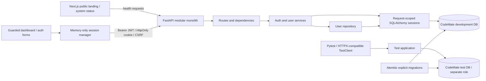
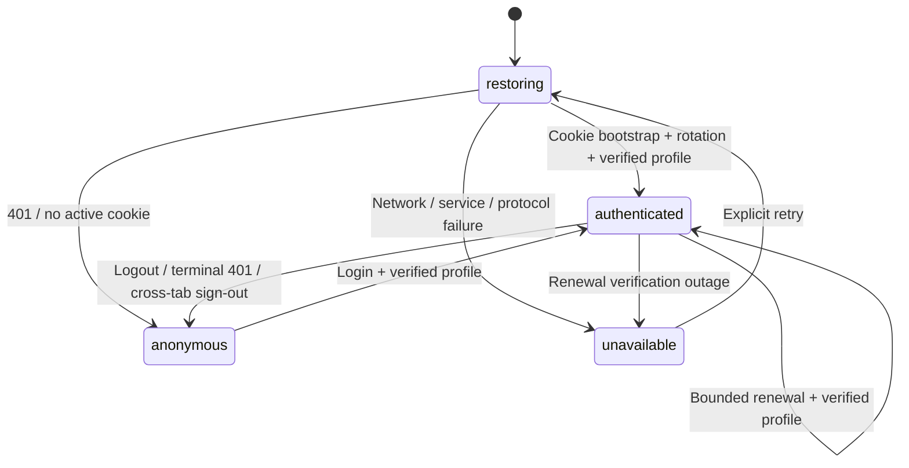
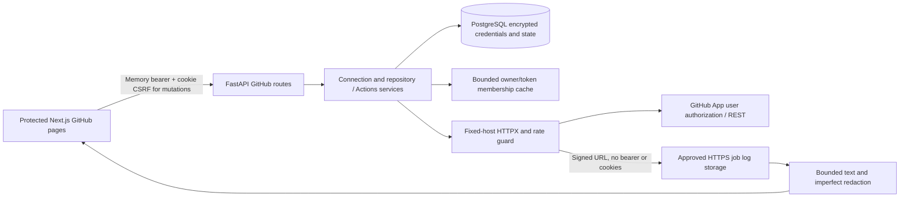

# CodeMate architecture - Milestones 1-4

The monolith uses Python 3.12, FastAPI, Pydantic 2, synchronous SQLAlchemy 2 typed
models, psycopg 3, and PostgreSQL 16. Synchronous endpoints/dependencies run in
FastAPI's worker thread pool. The GitHub module described below extends the same monolith. No Redis, Celery, AI
or voice modules are added.

## Composition and persistence

`app/main.py` composes configuration, routers, CORS, logging, sanitized exceptions,
and engine lifecycle. Engines are application-scoped; sessions are request-scoped.
Pool connections are checked before reuse, bounded to 5 + 5 overflow, and have
connection, pool, and statement timeouts. Sessions roll back on exceptions and
close on completion; lifespan cleanup always disposes the engine.

Services own commit boundaries. Registration translates uniqueness conflicts to
409. Login throttling commits independently before authentication so failed
attempts remain counted. Successful login commits hash upgrades and refresh
session creation together. Rotation locks the refresh row using SELECT FOR UPDATE,
checks expiry/revocation/user status, then revokes it and inserts a replacement in
one transaction. Failed creation rolls the entire transaction back. A second
concurrent request waits and sees revocation under PostgreSQL READ COMMITTED.

Users have UUID IDs, normalized unique email/username, Argon2id password hashes,
USER/ADMIN enum role, active status, and timezone-aware created/updated timestamps.
Refresh sessions have UUID IDs, cascading user foreign keys, unique token hashes,
UTC timestamps, expiry, and revocation state. Indexes cover user lookup and expiry;
uniqueness supplies the email, username, and token-hash indexes without duplication.
Login limits use hashed account/IP keys and atomic PostgreSQL upserts.

Alembic imports model metadata and explicitly applies migrations through
0002_github_integration, after the unchanged 0001_backend_core.
The API never calls metadata.create_all or automatically migrates on startup.
/health is process liveness; /health/ready verifies database access and migration
revision. Alembic check confirms no drift in either development or test schemas.

## Isolation

Compose project codemate-ai owns codemate-postgres and codemate-ai-postgres-data.
Only 127.0.0.1:5433 is bound, mapping to container port 5432. The guarded startup
script rejects a foreign container name or another listener on 5433. It never
stops, deletes, resets, or reconfigures VoxHire's independent port-5432 service.

codemate_user owns codemate_db; codemate_test_user owns codemate_test_db. Neither
application nor test role is a superuser. A separate codemate_owner bootstrap role
retains PostgreSQL-required administrative privileges and has its own generated
password in the ignored root environment file; the API never uses it. PUBLIC connection rights are revoked on both databases and
each role can connect only to its own database. They share CodeMate's local
instance, with no separate test port published. Init runs once for an empty volume;
credentials are generated locally and must not be changed without an explicit
password-rotation procedure. Local Docker operators can inspect container secrets;
this Compose setup is intended for trusted local development, not production secret
storage.

The test harness validates exact driver, database, user, host, and port before any
writes, then verifies current_database/session_user. It never substitutes SQLite.
It applies real migrations and clears only dedicated test tables between tests.
A test confirms the test role cannot connect to the development database.

## Authentication protocol

Access JWTs contain sub, jti, type=access, iss, aud, iat, nbf, and exp. HS256 is the
only accepted algorithm; expiry defaults to 15 minutes. No role, email, password,
or refresh secret is embedded. Every protected request rechecks account activation
and RBAC against current database state. Public registration forbids extra fields
and always assigns USER. Admin listing is paginated and uses response allowlists.
An operator CLI can create a new admin with a prompted password; there is no default
administrator or public promotion route.

Refresh tokens are random 48-byte secrets, delivered only as HttpOnly host-only
cookies. The database stores SHA-256 hashes. The refresh cookie is scoped to auth
routes, expires in seven days, and uses SameSite=Strict. Secure is required in
production; development explicitly permits local HTTP. Browser frontend and API
must be same-site HTTPS in production.

Login/refresh responses deliver a short-lived access token and an HMAC CSRF token
bound to the cookie. The frontend keeps access tokens in memory and obtains CSRF values inside each
serialized cookie mutation. On page reload it
gets /auth/csrf using the existing cookie and a custom header, then refreshes.
Refresh/logout verify the HMAC token; all session endpoints check supplied Origin
and require X-CodeMate-Request: 1. Narrow CORS permits credentials only for explicit
origins. This protects state changes and login without exposing the refresh secret
to JavaScript. Stateless access JWTs are not immediately revoked on logout;
deactivation denies them immediately, otherwise they expire normally.

Rotated-token replay is rejected but does not invalidate every user session or
the replacement token. Client tabs must coordinate refresh operations. This
milestone does not implement session-family-wide compromise detection.

## Operational limits

Login throttling is shared across backend processes via PostgreSQL; direct peer IP
is used, not an untrusted X-Forwarded-For header. The documented Uvicorn startup disables
proxy headers. If enabling them behind a proxy, explicitly configure trusted proxy
IPs before deployment. Throttling applies to successful attempts too; shared IPs and targeted
account lockouts can affect legitimate users. Registration abuse controls and
cluster/global concurrency limits must be addressed before public deployment.

Request logs use server-generated request IDs and structured JSON. No body, headers,
query string, passwords, tokens, or emails are logged. Pydantic validation responses
omit raw input/context; database errors hide parameters; unexpected errors expose
only a generic message and request ID. FastAPI docs remain at /docs.

Revoked/expired sessions and old throttle keys need a retention policy and cleanup
job in a later operational milestone. There is no password reset/email verification,
MFA, JWT key rotation, TLS termination, backups, or production deployment automation
yet. The development lockfile records the tested Windows/Python 3.12 environment;
production/platform-specific dependency locking and supply-chain audits remain work.

The frontend now implements Milestone 3. Public health checks remain separate from
identity verification and do not authorize dashboard content. Ollama is not required.
Future automation must keep model proposals separate from
execution, require exact-action approval, and use resource-limited restricted
containers without privileged mode or a Docker socket.

## Frontend composition

Next.js 16.4.0 App Router uses the existing strict TypeScript project, React 19.3,
Tailwind 4 and custom CSS variables. Lucide provides icons; React Hook Form and Zod
implement accessible client-side validation aligned with the actual Pydantic
contracts. Native Fetch implements credentials, no-store, an eight-second timeout,
safe HTTP errors and runtime response-schema checks. TanStack Query manages only
server data such as health and paginated users; it does not hold credentials.

`AppProviders` composes a stable QueryClient, browser preferences, toast notifications,
and the AuthProvider. Auth state is an external store exposed through
`useSyncExternalStore`, with a safe restoring server snapshot. Route groups separate
public `/login` and `/register` from the protected dashboard layout. Dashboard
modules provide the overview, profile, settings, live status and read-only admin list.
The root remains a documented public landing page. Missing routes and dashboard
render failures have safe generic error states without raw exception details.

The responsive workspace has a collapsible desktop sidebar, a native modal dialog
for mobile navigation (focus containment and Escape), account menu, avatar, skip
link, visible focus styles, dark/light themes and reduced motion. Preferences use
only `codemate-preferences` in localStorage and are labelled browser-local. Health
queries share cached data, poll every 60 seconds, and distinguish initial loading,
current failure and last successful check. Future repository/build/AI cards and
recent activity use honest unavailable/empty states, with no invented statistics.

## Frontend session state machine

SessionManager holds the access token, expiry and generation counter in private
memory. Its public snapshot contains only status, safe user data, error and notice.
A reload discards the token, bootstraps CSRF using the HttpOnly cookie, rotates,
then fetches `/api/v1/auth/me`. Access is published only after profile validation.
401 hides/clears identity; other restoration failures hide content and offer retry
without asserting that the session is anonymous. Generation checks discard stale
refresh/profile responses and reject stale protected GET responses after sign-out.

A single-flight promise coalesces renewal in each tab. Native Web Locks serialize
login, refresh and logout across same-origin tabs. CSRF bootstrap occurs inside
that lock, so it matches the currently selected shared cookie. BroadcastChannel
carries only `signed-in` / `signed-out` invalidations, never tokens or profiles.
Other tabs clear or independently verify identity rather than trusting a broadcast
boolean. Browsers without Web Locks have only the in-tab promise queue; reliable
multi-tab cookie rotation requires a browser with that API. BroadcastChannel absence
also limits immediate cross-tab invalidation. Edge with both APIs was exercised.

AuthProvider schedules one revalidation five seconds before access expiry and
checks overdue sessions when the page becomes visible. Renewal rechecks the
current profile, including backend role/status changes. An outage stops automatic
renewal and presents explicit retry. No access token is exposed in the UI. Protected
GETs refresh near expiry or retry once after 401; 403 and network failures do not
trigger refresh loops. Non-idempotent login/register/refresh/logout requests have
no automatic retries. Profile loading is shared across protected pages rather than
repeated on every navigation.

Logout clears local identity and user-query caches before waiting for the API,
invalidates other tabs, bootstraps current CSRF and requests server revocation.
Only a successful 204 is labelled verified revocation. Failure leaves a persistent
local-only notice explaining that the cookie could restore after reload. The
backend's stateless JWT lifetime and session-family limits remain unchanged.

The client layout guard prevents content flashes, but it is not server authorization.
SSR renders loading only; the auth-only refresh cookie is never exposed to Next.
Every data request remains subject to FastAPI authentication and current DB RBAC.
The admin page sends only authenticated GETs with bounded pagination and displays
403 distinctly. There are no edit/delete/promotion APIs or frontend controls.

## Frontend verification and limits

49 Vitest/React Testing Library tests use mocked Fetch. Five Playwright tests run
real Edge against the FastAPI test application and PostgreSQL, with network abortion
only for outage scenarios. The E2E helper independently validates the exact test URL
and live database/role before any writes. It applies real migrations, resets test
throttle keys for its exclusive run, and cleans up only the exact generated test
usernames/emails (session deletion cascades). No development DB environment override
is accepted. Test credentials are generated in process memory; traces/video are off.
The runner refuses occupied ports rather than terminating foreign processes, owns
its child PIDs, and uses `.next-e2e` separately from `.next`.

During Milestone 3, backend source, cookies, CORS, security configuration and
migrations did not change; Milestone 4 adds the module described below.
Browser validation covers Edge at desktop/mobile sizes; no claim is made about a
full browser/device matrix or a formal WCAG audit. Production deployment still needs
TLS, same-site origins, operational monitoring, backup/retention policy and a review
of web security headers/CSP. Five development-only braces-chain findings remain
unpatched; production npm audit reports zero. GitHub is now implemented in
Milestone 4 with live verification pending. AI (Milestone 5),
voice and automation have not begun.

## Milestone 4: read-only GitHub module

The existing modular monolith now includes `integrations/github` (bounded HTTPX,
DTO normalization, credential encryption, safe exceptions, log redaction, rate guard
and authorization cache), connection/repository services and repositories, and
`api/routes/github.py`. Repository and Actions reads share authorization rather than
duplicating it in separate microservices. Request-scoped synchronous SQLAlchemy and
HTTPX run in FastAPI's sync worker threads with bounded network concurrency.

`GitHubConnection` has unique CodeMate and GitHub ownership, encrypted nullable
access/refresh credentials, expiry/status and safe metadata. `GitHubOAuthState` holds
hashed state/browser nonce, encrypted PKCE verifier and originating session identity.
The new additive Alembic revision is 0002. Foreign keys cascade on owner deletion;
repository source and raw logs are not persisted. Connection mutations retain the
existing refresh-cookie scope by using `/api/v1/auth/github`; reads and callback use
`/api/v1/github`. Browser callbacks require single-use state and a separate Lax nonce
cookie, not a bearer header on navigation. Session ownership is checked before and
after authorization exchange. Separate Fernet configuration is mandatory for tokens.

The frontend adds typed Zod GitHub DTOs, user-separated TanStack Query hooks,
connection/explorer/activity/monitor/investigation components and five protected
routes. Connection mutations serialize with existing cookie locks and use fresh
CSRF, without automatic POST retries. GitHub 401 is mapped to 424, preserving the
CodeMate session. Logout/session transitions/disconnect remove GitHub caches.
No log data or credentials are stored in browser storage. Query results are bounded
and kept only in memory. The overview uses actual installation/page-scoped previews.

No App write permissions, webhooks, Redis, workflow controls, AI or voice services
are added. Production transport always uses approved GitHub endpoints; a controlled
MockTransport injection is permitted only in test environment. E2E keeps its existing
separate database/process guards. See GITHUB_INTEGRATION.md for the API reference,
permission sources, state machine, data retention, deadlines and known limitations.
