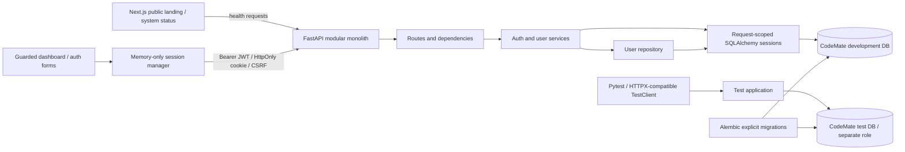
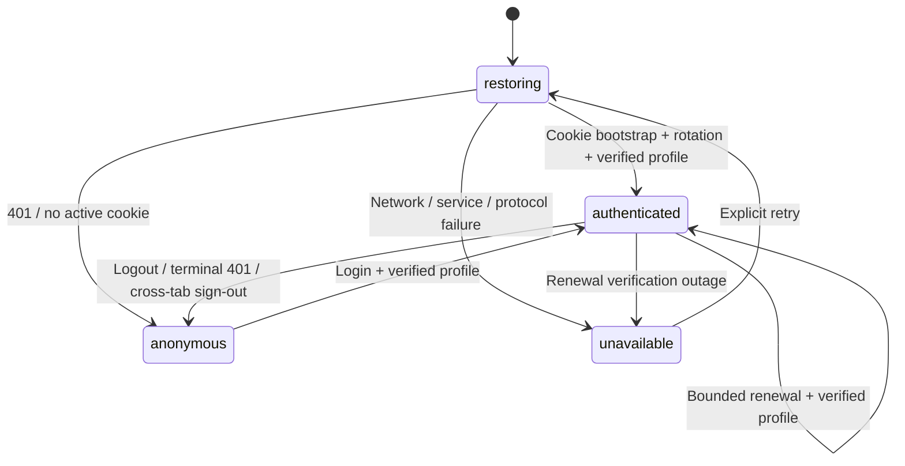
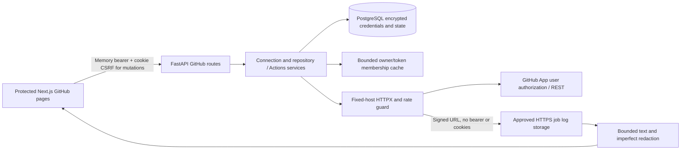

# CodeMate architecture - Milestones 1-5

The monolith uses Python 3.12, FastAPI, Pydantic 2, synchronous SQLAlchemy 2 typed
models, psycopg 3, and PostgreSQL 16. Synchronous endpoints/dependencies run in
FastAPI's worker thread pool. The GitHub module described below extends the same monolith. Milestone 5 adds the bounded local AI module described below; no Redis, Celery
or voice modules are added.

## Composition and persistence

`app/main.py` composes configuration, routers, CORS, logging, sanitized exceptions,
and engine lifecycle. Engines are application-scoped; sessions are request-scoped.
Pool connections are checked before reuse, bounded to 5 + 5 overflow, and have
connection, pool, and statement timeouts. Sessions roll back on exceptions and
close on completion; lifespan cleanup always disposes the engine.

Services own commit boundaries. Registration translates uniqueness conflicts to
409. Login throttling commits independently before authentication so failed
attempts remain counted. Successful login commits hash upgrades and refresh
session creation together. Rotation locks the refresh row using SELECT FOR UPDATE,
checks expiry/revocation/user status, then revokes it and inserts a replacement in
one transaction. Failed creation rolls the entire transaction back. A second
concurrent request waits and sees revocation under PostgreSQL READ COMMITTED.

Users have UUID IDs, normalized unique email/username, Argon2id password hashes,
USER/ADMIN enum role, active status, and timezone-aware created/updated timestamps.
Refresh sessions have UUID IDs, cascading user foreign keys, unique token hashes,
UTC timestamps, expiry, and revocation state. Indexes cover user lookup and expiry;
uniqueness supplies the email, username, and token-hash indexes without duplication.
Login limits use hashed account/IP keys and atomic PostgreSQL upserts.

Alembic imports model metadata and explicitly applies migrations through
0002_github_integration, after the unchanged 0001_backend_core.
The API never calls metadata.create_all or automatically migrates on startup.
/health is process liveness; /health/ready verifies database access and migration
revision. Alembic check confirms no drift in either development or test schemas.

## Isolation

Compose project codemate-ai owns codemate-postgres and codemate-ai-postgres-data.
Only 127.0.0.1:5433 is bound, mapping to container port 5432. The guarded startup
script rejects a foreign container name or another listener on 5433. It never
stops, deletes, resets, or reconfigures VoxHire's independent port-5432 service.

codemate_user owns codemate_db; codemate_test_user owns codemate_test_db. Neither
application nor test role is a superuser. A separate codemate_owner bootstrap role
retains PostgreSQL-required administrative privileges and has its own generated
password in the ignored root environment file; the API never uses it. PUBLIC connection rights are revoked on both databases and
each role can connect only to its own database. They share CodeMate's local
instance, with no separate test port published. Init runs once for an empty volume;
credentials are generated locally and must not be changed without an explicit
password-rotation procedure. Local Docker operators can inspect container secrets;
this Compose setup is intended for trusted local development, not production secret
storage.

The test harness validates exact driver, database, user, host, and port before any
writes, then verifies current_database/session_user. It never substitutes SQLite.
It applies real migrations and clears only dedicated test tables between tests.
A test confirms the test role cannot connect to the development database.

## Authentication protocol

Access JWTs contain sub, jti, type=access, iss, aud, iat, nbf, and exp. HS256 is the
only accepted algorithm; expiry defaults to 15 minutes. No role, email, password,
or refresh secret is embedded. Every protected request rechecks account activation
and RBAC against current database state. Public registration forbids extra fields
and always assigns USER. Admin listing is paginated and uses response allowlists.
An operator CLI can create a new admin with a prompted password; there is no default
administrator or public promotion route.

Refresh tokens are random 48-byte secrets, delivered only as HttpOnly host-only
cookies. The database stores SHA-256 hashes. The refresh cookie is scoped to auth
routes, expires in seven days, and uses SameSite=Strict. Secure is required in
production; development explicitly permits local HTTP. Browser frontend and API
must be same-site HTTPS in production.

Login/refresh responses deliver a short-lived access token and an HMAC CSRF token
bound to the cookie. The frontend keeps access tokens in memory and obtains CSRF values inside each
serialized cookie mutation. On page reload it
gets /auth/csrf using the existing cookie and a custom header, then refreshes.
Refresh/logout verify the HMAC token; all session endpoints check supplied Origin
and require X-CodeMate-Request: 1. Narrow CORS permits credentials only for explicit
origins. This protects state changes and login without exposing the refresh secret
to JavaScript. Stateless access JWTs are not immediately revoked on logout;
deactivation denies them immediately, otherwise they expire normally.

Rotated-token replay is rejected but does not invalidate every user session or
the replacement token. Client tabs must coordinate refresh operations. This
milestone does not implement session-family-wide compromise detection.

## Operational limits

Login throttling is shared across backend processes via PostgreSQL; direct peer IP
is used, not an untrusted X-Forwarded-For header. The documented Uvicorn startup disables
proxy headers. If enabling them behind a proxy, explicitly configure trusted proxy
IPs before deployment. Throttling applies to successful attempts too; shared IPs and targeted
account lockouts can affect legitimate users. Registration abuse controls and
cluster/global concurrency limits must be addressed before public deployment.

Request logs use server-generated request IDs and structured JSON. No body, headers,
query string, passwords, tokens, or emails are logged. Pydantic validation responses
omit raw input/context; database errors hide parameters; unexpected errors expose
only a generic message and request ID. FastAPI docs remain at /docs.

Revoked/expired sessions and old throttle keys need a retention policy and cleanup
job in a later operational milestone. There is no password reset/email verification,
MFA, JWT key rotation, TLS termination, backups, or production deployment automation
yet. The development lockfile records the tested Windows/Python 3.12 environment;
production/platform-specific dependency locking and supply-chain audits remain work.

The frontend now implements Milestone 3. Public health checks remain separate from
identity verification and do not authorize dashboard content. Ollama is not required.
Future automation must keep model proposals separate from
execution, require exact-action approval, and use resource-limited restricted
containers without privileged mode or a Docker socket.

## Frontend composition

Next.js 16.4.0 App Router uses the existing strict TypeScript project, React 19.3,
Tailwind 4 and custom CSS variables. Lucide provides icons; React Hook Form and Zod
implement accessible client-side validation aligned with the actual Pydantic
contracts. Native Fetch implements credentials, no-store, an eight-second timeout,
safe HTTP errors and runtime response-schema checks. TanStack Query manages only
server data such as health and paginated users; it does not hold credentials.

`AppProviders` composes a stable QueryClient, browser preferences, toast notifications,
and the AuthProvider. Auth state is an external store exposed through
`useSyncExternalStore`, with a safe restoring server snapshot. Route groups separate
public `/login` and `/register` from the protected dashboard layout. Dashboard
modules provide the overview, profile, settings, live status and read-only admin list.
The root remains a documented public landing page. Missing routes and dashboard
render failures have safe generic error states without raw exception details.

The responsive workspace has a collapsible desktop sidebar, a native modal dialog
for mobile navigation (focus containment and Escape), account menu, avatar, skip
link, visible focus styles, dark/light themes and reduced motion. Preferences use
only `codemate-preferences` in localStorage and are labelled browser-local. Health
queries share cached data, poll every 60 seconds, and distinguish initial loading,
current failure and last successful check. Future repository/build/AI cards and
recent activity use honest unavailable/empty states, with no invented statistics.

## Frontend session state machine

SessionManager holds the access token, expiry and generation counter in private
memory. Its public snapshot contains only status, safe user data, error and notice.
A reload discards the token, bootstraps CSRF using the HttpOnly cookie, rotates,
then fetches `/api/v1/auth/me`. Access is published only after profile validation.
401 hides/clears identity; other restoration failures hide content and offer retry
without asserting that the session is anonymous. Generation checks discard stale
refresh/profile responses and reject stale protected GET responses after sign-out.

A single-flight promise coalesces renewal in each tab. Native Web Locks serialize
login, refresh and logout across same-origin tabs. CSRF bootstrap occurs inside
that lock, so it matches the currently selected shared cookie. BroadcastChannel
carries only `signed-in` / `signed-out` invalidations, never tokens or profiles.
Other tabs clear or independently verify identity rather than trusting a broadcast
boolean. Browsers without Web Locks have only the in-tab promise queue; reliable
multi-tab cookie rotation requires a browser with that API. BroadcastChannel absence
also limits immediate cross-tab invalidation. Edge with both APIs was exercised.

AuthProvider schedules one revalidation five seconds before access expiry and
checks overdue sessions when the page becomes visible. Renewal rechecks the
current profile, including backend role/status changes. An outage stops automatic
renewal and presents explicit retry. No access token is exposed in the UI. Protected
GETs refresh near expiry or retry once after 401; 403 and network failures do not
trigger refresh loops. Non-idempotent login/register/refresh/logout requests have
no automatic retries. Profile loading is shared across protected pages rather than
repeated on every navigation.

Logout clears local identity and user-query caches before waiting for the API,
invalidates other tabs, bootstraps current CSRF and requests server revocation.
Only a successful 204 is labelled verified revocation. Failure leaves a persistent
local-only notice explaining that the cookie could restore after reload. The
backend's stateless JWT lifetime and session-family limits remain unchanged.

The client layout guard prevents content flashes, but it is not server authorization.
SSR renders loading only; the auth-only refresh cookie is never exposed to Next.
Every data request remains subject to FastAPI authentication and current DB RBAC.
The admin page sends only authenticated GETs with bounded pagination and displays
403 distinctly. There are no edit/delete/promotion APIs or frontend controls.

## Frontend verification and limits

49 Vitest/React Testing Library tests use mocked Fetch. Five Playwright tests run
real Edge against the FastAPI test application and PostgreSQL, with network abortion
only for outage scenarios. The E2E helper independently validates the exact test URL
and live database/role before any writes. It applies real migrations, resets test
throttle keys for its exclusive run, and cleans up only the exact generated test
usernames/emails (session deletion cascades). No development DB environment override
is accepted. Test credentials are generated in process memory; traces/video are off.
The runner refuses occupied ports rather than terminating foreign processes, owns
its child PIDs, and uses `.next-e2e` separately from `.next`.

During Milestone 3, backend source, cookies, CORS, security configuration and
migrations did not change; Milestone 4 adds the module described below.
Browser validation covers Edge at desktop/mobile sizes; no claim is made about a
full browser/device matrix or a formal WCAG audit. Production deployment still needs
TLS, same-site origins, operational monitoring, backup/retention policy and a review
of web security headers/CSP. Five development-only braces-chain findings remain
unpatched; production npm audit reports zero. GitHub is now implemented in
Milestone 4 with live verification pending. AI (Milestone 5),
voice and automation have not begun.

## Milestone 4: read-only GitHub module

The existing modular monolith now includes `integrations/github` (bounded HTTPX,
DTO normalization, credential encryption, safe exceptions, log redaction, rate guard
and authorization cache), connection/repository services and repositories, and
`api/routes/github.py`. Repository and Actions reads share authorization rather than
duplicating it in separate microservices. Request-scoped synchronous SQLAlchemy and
HTTPX run in FastAPI's sync worker threads with bounded network concurrency.

`GitHubConnection` has unique CodeMate and GitHub ownership, encrypted nullable
access/refresh credentials, expiry/status and safe metadata. `GitHubOAuthState` holds
hashed state/browser nonce, encrypted PKCE verifier and originating session identity.
The new additive Alembic revision is 0002. Foreign keys cascade on owner deletion;
repository source and raw logs are not persisted. Connection mutations retain the
existing refresh-cookie scope by using `/api/v1/auth/github`; reads and callback use
`/api/v1/github`. Browser callbacks require single-use state and a separate Lax nonce
cookie, not a bearer header on navigation. Session ownership is checked before and
after authorization exchange. Separate Fernet configuration is mandatory for tokens.

The frontend adds typed Zod GitHub DTOs, user-separated TanStack Query hooks,
connection/explorer/activity/monitor/investigation components and five protected
routes. Connection mutations serialize with existing cookie locks and use fresh
CSRF, without automatic POST retries. GitHub 401 is mapped to 424, preserving the
CodeMate session. Logout/session transitions/disconnect remove GitHub caches.
No log data or credentials are stored in browser storage. Query results are bounded
and kept only in memory. The overview uses actual installation/page-scoped previews.

No App write permissions, webhooks, Redis, workflow controls, AI or voice services
are added. Production transport always uses approved GitHub endpoints; a controlled
MockTransport injection is permitted only in test environment. E2E keeps its existing
separate database/process guards. See GITHUB_INTEGRATION.md for the API reference,
permission sources, state machine, data retention, deadlines and known limitations.

## Milestone 5: local diagnostic graph and durable worker

`app/ai` defines strict reports, deterministic evidence extraction, eight finite
LangGraph nodes and a PostgreSQL-backed investigation worker. `integrations/ollama`
uses native JSON-schema HTTPX inference at the exact loopback endpoint, with no
cloud model fallback or model tools. `services/ai_investigation_service.py` owns
idempotent admission/history/retry/cancel/delete transactions. `api/routes/ai.py`
reuses bearer authentication and matching active cookie-session CSRF checks.
Browser POST aliases under `/api/v1/auth/ai` preserve the original cookie scope.

New additive revision 0003 creates the owner/connection-scoped investigation table,
indexes, foreign keys, state/attempt constraints and 128 KiB report bound. Findings
and redacted evidence live in a validated JSONB report. API startup never migrates
or requires Ollama. Job/account/global session advisory locks prevent concurrent
execution; process loss releases locks so another worker can restart the finite
graph within the same attempt budget. Reports, stages and failures are durable;
individual graph-node checkpoints are not persisted. Retention is worker-driven.

The protected AI overview/report pages reuse the session manager, Zod and query
cache, with abortable reads, bounded polling, explicit errors/retries, inert
collapsible evidence and qualitative confidence. Model output never executes.
Success metadata bypasses inference. No repository/source/workflow writes were
added. See [AI_DIAGNOSTICS.md](AI_DIAGNOSTICS.md) for the graph, exact limits,
threat model, Windows commands and remaining operational limits.

## Milestone 6: bounded local voice agent

`/dashboard/voice` supports typed commands and explicit browser push-to-talk.
MediaRecorder uploads a raw WebM/Ogg/MP4 Blob through the existing authenticated
client. JWT, refresh-cookie ownership, origin/custom-header checks and CSRF are
required for all mutations under `/api/v1/auth/voice`. Read-only status and history
use `/api/v1/voice`. No bearer tokens appear in URLs or browser storage.

A separate bounded LangGraph performs typed intent interpretation and authorized
tool dispatch. Known commands are deterministic; variations use structured local
Ollama output validated against an enum-only Pydantic schema. The model cannot
supply API paths, run IDs, installations, SQL, shell instructions or executable
URLs. Context targets come only from authorized GitHub responses. Ambiguous
repository lookups ask the user to select a real owner/repository. Pipeline lookup
uses the first 30 runs of that repository; repository discovery is bounded to the
first 100 repositories of up to five installations. It never claims exhaustive
search across arbitrary organizations. Exact selected runs are rechecked through
the existing GitHub service. Logs link to the existing secure log viewer rather
than being copied wholesale into speech or model context. General explanations
are labeled as general knowledge and do not claim a GitHub query.

VoiceSession stores owner, expiry and a small repository/workflow context;
VoiceTurn keeps up to 20 bounded assistant replies and intent metadata per session.
Transcripts are not retained unless VOICE_RETAIN_TRANSCRIPTS is explicitly enabled.
VoiceAction stores the immutable exact target, expiry, state and resulting
investigation ID. VoiceBudget maintains a per-user one-minute request budget.
Expiry is enforced on every access. Expired sessions and cascading metadata are
removed on the next voice mutation by their owner. Idle expired data can remain
on disk until that cleanup; external backups have their own retention policies.
The additive 0004 migration does not rewrite users, connections or investigations.

Investigation creation requires a stored pending action and an explicit Confirm
button. Voice-only yes only redisplays the pending confirmation. Confirm rechecks
session ownership, active application session, original GitHub connection and the
exact workflow status/conclusion. Altered request bodies are rejected. Used,
cancelled and expired actions cannot execute. A dedicated PostgreSQL session
advisory lock serializes commands/confirmations per user across service commits;
it is released in finally. Existing investigation creation provides same-run
idempotency, including recovery if the API stops after creation but before marking
the action used. Confirmation replays return an error rather than silently running
again. No repository modifications or deployments are exposed.

Speech inference is lazy and serialized in owned subprocesses. PyAV bundles the
FFmpeg decoding libraries; no external FFmpeg executable is required. MIME and
container signatures must agree; decoded duration and sample count are bounded.
Empty/silent recordings produce errors, not invented transcripts. faster-whisper
uses a configured local directory and local_files_only=True. CPU int8 is default;
auto/CUDA requests fall back to CPU if detection or initialization fails. Piper
loads a configured local ONNX voice/config lazily. Inference timeout terminates
owned speech workers, which can restart on the next request. Audio remains in
memory and is not persisted by the API. The explicit smoke script may save a
synthetic WAV in an ignored verification directory.

The command gate is configured per API process and the speech gate is serialized
per process. Run one API worker for predictable laptop model/RAM limits; multiple
API processes multiply model copies and process-local concurrency limits. Durable
per-user rate limits and confirmation locks still use PostgreSQL. Status reports
file installation, not proof that model initialization or physical audio devices
will succeed. Browser upload timeout is 15 seconds; inference timeout defaults to
60 seconds. Local Ollama intent/explanation calls have 30-second timeouts, no
implicit retries, and bounded response sizes through the existing Ollama adapter.

All responses are plain text. Internal routes are constructed by backend tools
and independently allowlisted in the frontend. Piper speaks only an owned saved
assistant turn, capped at 800 characters, using existing secret-pattern redaction.
Redaction is imperfect; short summaries may still contain unforeseen sensitive
content. Nothing executes text from transcripts, GitHub content or generated
responses. Audit logs contain event/intent metadata, not audio or transcript text.

### Voice REST contracts

| Method | Path | Body or response |
| --- | --- | --- |
| GET | /api/v1/voice/status | Enabled/model-file/Ollama state and audio limits |
| POST | /api/v1/auth/voice/transcribe?language=en | Raw audio Blob; returns text and detected language; en/fr/auto allowed |
| POST | /api/v1/auth/voice/command | text, request_id UUID, optional session_id UUID; returns typed reply, safe route, choices or pending action |
| GET | /api/v1/voice/sessions/{id} | Up to 20 owner-scoped saved replies |
| POST | /api/v1/auth/voice/confirm | session_id and action_id only; returns confirmed investigation route |
| POST | /api/v1/auth/voice/cancel | session_id and action_id only; cancels pending action |
| POST | /api/v1/auth/voice/speech | session_id and turn_id only; returns audio/wav with no-store |

All routes require JWT. Mutations also require refresh-cookie ownership and CSRF.
Commands use request UUID deduplication within a supplied session. The browser
stores only that conversation UUID under an account-specific sessionStorage key;
it sends no retained audio or authentication credentials to model downloads.

Hosted LangGraph tracing is explicitly disabled for voice, matching the existing
local investigation graph. Intent state distinguishes previous-workflow references
from explicit latest-failed searches; failure searches also validate conclusions
from returned GitHub data. Repository changes discard older workflow references.

## Milestone 7: bounded developer automation and review

The automation page reuses the authenticated client, GitHub installation picker,
repository service, local Ollama adapter and existing dark dashboard shell.
All mutations require JWT, active refresh-cookie ownership, CSRF and origin/custom
header checks. Reads require JWT. Snapshot detail, generation and review recheck
repository authorization and the original GitHub connection. History lists only
the current owner's unexpired session metadata. Responses use no-store.

### Proposal-only workspace boundary

The first delivery deliberately uses a logical snapshot workspace in PostgreSQL,
identified by a generated UUID, not a host checkout. It does not materialize files,
follow symlinks or junctions, mount directories, invoke subprocesses or expose a
Docker socket. A filesystem workspace root, canonical/reparse-point checks and
runner service are deferred with patch application and execution. The web API
cannot enable execution through an environment switch. `/execute` always returns
503 and records a denial. No execution results are invented or persisted.

GitHubRepositoryService proves installation membership before read-only Git Data
requests. A selected completed or in-progress run supplies its exact commit SHA;
without a run, the default branch is resolved once to an exact SHA. The commit
pins a Git tree. Trees must be untruncated and contain at most 5,000 entries.
Only explicitly selected existing regular non-executable `100644` blobs are read.
Symlinks (`120000`), submodules, executables, missing files and case-colliding paths
are rejected. Every ancestor must be a Git tree, not a link. Blob Git SHA-1 and
reported length are verified; proposal before/after hashes use SHA-256.

Paths are a deliberately restrictive ASCII subset: relative paths only, no drive
prefixes, backslashes, alternate data streams, empty/dot/parent segments, Windows
reserved names, trailing dots/spaces or sensitive/generated components. Secret
and credential-related filenames are rejected. Supported text extensions are
py, ts, tsx, js, mjs, json, yaml, yml, toml, md and txt. At most four files,
12 KB/file and 24 KB total are inspected. Binary/invalid UTF-8/control-character
content is rejected. CRLF source hashes are preserved; generated LF replacements
inherit a source file's CRLF convention. Raw LLM diff hunks are never accepted.

Optional CI evidence uses existing authorized run/job/log retrieval, timeout and
redirect protections. Up to ten job metadata entries are fetched; the first two
jobs can contribute metadata and at most 2,000 characters of failed-job redacted
logs each. Logs may be unavailable. The UI distinguishes source-only sessions.
Known secret patterns and actual GitHub credentials are redacted or rejected
before persistence/model use. Pattern detection is imperfect: private source
can contain unforeseen sensitive information. Select source files deliberately.

### Bounded graph and review authority

A separate LangGraph calls local Ollama once and then validates structured output.
There are no model tools, command dispatch, autonomous retries or background
repair workers. A 90-second provider deadline, existing response limit, recursion
limit four and one in-process generation slot bound the graph. Source, logs and
user text are explicitly untrusted data. Model-suggested evidence quotes must
match retrieved source/evidence keys. This checks observations, not correctness
of the proposed repair. The UI labels explanations and improvements unverified.
Strict Pydantic models reject extra fields, invented validation commands and raw
patches. Only distinct selected existing files can change; before hashes must
match. The backend creates the unified diff from bounded typed replacements.
The complete stored proposal is hashed with owner, workspace, repository,
connection and base commit. No Markdown or HTML from the model is executed.

A real dialog click records a review decision bound to those fields, allowed
validation target IDs and expiry. Voice phrases only navigate to the review page.
They cannot approve or apply anything. Expired, already-decided, altered or replayed
proposals fail. A dedicated per-user PostgreSQL advisory lock survives upstream
service commits and prevents concurrent double decisions. Persisted request UUIDs
and unique constraints deduplicate snapshot creation and successful proposal
retries; a reused UUID with a different request is rejected. Restarting the API
cannot execute a stored approval because no executor exists.

The backend enumerates python_syntax, python_tests, typescript and eslint command
**templates for review only**. They are never launched. A future runner must use a
separate narrow interface, disposable non-root container, no network or host keys,
no application secrets, no Docker socket in the web process, approved mounts and
verified CPU/memory/PID/time/output limits. Existing project scripts are untrusted
inside such a runner, even when the executable is allowlisted. Network isolation,
host isolation, cancellation of execution and resource exhaustion have not been
verified here. Fail-closed API tests are not sandbox verification.

### Persistence, quotas and API

Additive migration `0005_safe_automation` follows `0004_voice_agent` and creates
`automation_sessions`, `automation_proposals`, `automation_audit` and
`automation_budgets`. Foreign keys cascade only within new automation metadata
when an owner/connection is removed. Existing tables are not rewritten.
Sessions retain bounded private source snapshots and evidence for 24 hours;
proposals accept review for 30 minutes. Approval metadata additionally records a
maximum five-minute review grant, never reusable as execution authority. Six
mutations/minute/user, ten active snapshots/user and five proposals/session bound
storage and inference. Expired sessions are deleted on the owner's next mutation;
idle expired rows and external backups may remain until maintenance/backup expiry.
Reads enforce expiry even before cleanup. Audit events contain types/timestamps,
not raw secrets, arbitrary command output or full CI logs. The UI shows the latest
50 events for each session. Existing request logs cover denied API requests.

| Method | Route | Purpose |
| --- | --- | --- |
| GET | /api/v1/automation/capabilities | Hard-disabled execution and review templates |
| GET | /api/v1/automation/sessions | Owner-only recent snapshot metadata |
| GET | /api/v1/automation/sessions/{id} | Reauthorized context, diffs and audit history |
| POST | /api/v1/auth/automation/sessions | Idempotent source snapshot creation |
| POST | /api/v1/auth/automation/sessions/{id}/proposals | Structured explanation or validated patch suggestion |
| POST | /api/v1/auth/automation/sessions/{id}/proposals/{proposal}/decision | Exact review approval, rejection or cancellation |
| POST | /api/v1/auth/automation/sessions/{id}/execute | Always 503, audited execution denial |

Preparing and approving a proposal does not change the selected branch or commit.
Changing the desired revision or source selection requires a new snapshot and
review. Repeat Generate with the same unchanged request to retrieve its successful
proposal; edit the request to deliberately ask for another. A cancelled pending
proposal cannot be approved later. In-flight synchronous generation has a timeout
but no server cancellation endpoint; leaving the page ignores its browser result
and does not guarantee cancelling a model request already sent.

### Milestone 7 final grounding and review history

The graph includes a backend-owned required-source-to-evidence-ID map for files
explicitly named in an explanation request. Validation rejects missing coverage
without saving a suggestion. Patch proposals require source evidence for every
changed file. These deterministic checks do not prove semantic relevance or the
truth of model prose; independent source review remains necessary. The backend
labels every generated risk an unverified hypothesis and caps HIGH confidence at
MEDIUM. The viewer also labels legacy risk statements as unverified hypotheses.
No repository-specific framework conclusions are hardcoded.

Proposal expiry closes pending review. Already approved, rejected, cancelled and
explained records retain their status until parent-session retention expires.
Ownership, exact content-hash binding, single-use decisions and disabled execution
are unchanged. No schema change was needed beyond existing 0005_safe_automation.
See [final verification](MILESTONE_7_FINAL_VERIFICATION.md) for current results and
limits, including the distinction between real upstream checks and fixture E2E.

Multi-file explanation follow-up: the graph now scopes one compact local Ollama
selection call per inspected file. Backend Python AST observations or explicit
extractive prefixes are tied to original citation IDs and exact quoted lines.
The model can select relevant observations but cannot add prose to the combined
summary. Missing/wrong-file IDs fail without saving a partial result. Calls are
bounded to four, 192 generated tokens each, 35 seconds each and 90 seconds total,
with no automatic retry or second synthesis. Single-file and patch paths remain
unchanged. See MILESTONE_7_FINAL_VERIFICATION.md for live persistence results.

## Milestone 8 preparation trust boundary

The sandbox preparation API composes existing AutomationService authorization,
GitHub membership, owner identity, CSRF and active-session checks. A separate
SandboxService rechecks the current approved proposal hash and regenerates M7
patch artifacts from the pinned text and typed replacements. It refuses changed
source, approval bindings, unsupported paths, empty changes and artifact mismatch.
It does not parse or execute model shell strings.

PostgreSQL sandbox_previews stores a generated UUID, owner, unique owner/request
key, nullable proposal reference, complete immutable preview, binding hash, state,
creation time and expiry. sandbox_audit stores bounded-category events linked to
that preview. Proposal deletion sets its reference to NULL, retaining the historical
preview; user deletion cascades. No previous tables are rewritten by migration
0006_sandbox_previews. Downgrade removes only the new tables and is never required
on a development database.

Preview state is awaiting_confirmation -> cancelled or expired. There is no
transition to authorized, queued or running in this fallback. A five-minute expiry
also cannot exceed source/proposal expiry. Owner advisory locks serialize mutations;
concurrent operations can receive BUSY/409 and an unchanged retry restores one
record. A database uniqueness constraint enforces owner/request idempotency. At
most 100 previews are retained per account and 50 returned in history. Each audit
category is recorded once per preview, preventing repeated-denial audit growth.
History and details recheck repository permissions. Expiry does not fabricate an
execution result. Expected after-hashes are labeled separately from actual changes.

GET /api/v1/sandbox/capabilities reports unverified isolation and execution_enabled
false. GET /api/v1/sandbox/executions and /executions/{id} return owner-scoped
preparation history/details. POST /api/v1/auth/sandbox/executions accepts only
request_id, session_id, proposal_id and profiles=[python_syntax]. POST
/executions/{id}/cancel cancels preparation idempotently. POST
/executions/{id}/confirm accepts only binding_hash and interaction=ui_click,
revalidates the original request, then always returns SANDBOX_UNVERIFIED/503.
The UI-click field is a request contract, not proof of human presence or an
authorization mechanism. Voice never invokes this endpoint. All mutations reuse
CSRF, Origin/custom-header and active cookie/bearer account binding.

No Docker library, socket, CLI invocation, environment override or command runner
is present in the web application. A separate execution service, credential-free
source handoff, trusted materializer, verified image, leases and cancellation of
running code remain prerequisites. See MILESTONE_8_VERIFICATION.md for threats,
proposed controls and evidence limits. This describes the Milestone 8 baseline.

## Milestone 9 fixture prototype boundary

The standalone operator tool in infrastructure/sandbox is outside FastAPI, the AI
worker and application configuration. It accepts only an immutable local image ID
and explicit operator opt-in. Five fixed fixtures have no repository/source/command
input. The tool controls the local desktop-linux Docker endpoint and therefore has
operator privileges; this is not the restricted production launcher design.

The Docker build context allowlists only Dockerfile and probe.py. No host paths,
credentials, socket, package cache or app environment are mounted or forwarded.
Containers have network none, UID/GID 65532, read-only root, no-new-privileges,
dropped capabilities, built-in seccomp, private PID/cgroup namespaces, IPC none,
128 MiB memory and swap cap, half CPU, 32 PIDs, 8 MiB tmpfs and no persistent log
driver. Output is read through capped pipes. Actual configuration is checked before
starting each fixture. These prototype limits differ from the inert M8 proposal;
M8 previews are not silently upgraded to a new isolation profile.

The trusted fixed probe writes an original and replacement fixture to container
tmpfs and parses the replacement with ast.parse. This does not execute imports,
apply an approved GitHub patch or integrate with application execution records.
Other cases test bounded PID exhaustion, cgroup OOM termination, timeout and a
scheduled harness cancellation. Exact owned containers are removed in finally.
Process death or daemon failure can interrupt cleanup; no orphan recovery service
is implemented. No automatic queue retries exist.

Threat model and trust boundaries: [MILESTONE_9_THREAT_MODEL.md](MILESTONE_9_THREAT_MODEL.md).
The required worker/launcher separation and image provenance are unverified. A
dedicated sandbox VM/service needs review before hostile code is accepted. The
API retains hard confirmation denial, Literal false response contracts and no
Docker integration. The existing preparation UI remains honest and disabled.
Safe voice additions navigate to automation for last result, failed validation
and tested patch requests; they do not claim a result exists or start execution.

## Milestone 10 admission preparation and restricted-service design

GET /api/v1/sandbox/capabilities remains authenticated and no-store. Its new strict
response model adds readiness with policy_version=m10-readiness-v1, state=blocked
and six distinct requirements: worker_identity, launcher_boundary, image_provenance,
hostile_isolation, durable_recovery and fixture_integration. Statuses can only be
not_implemented or unverified. There is no approved status or enable override.
Readiness is generated as fresh metadata, not loaded from the local fixture JSON.
It does not change the M8 preview isolation policy, hashes or confirmation binding.

The frontend independently validates the same blocked contract, displays each
requirement as inert text and reports invalid readiness. Run remains disabled and
the confirmation endpoint independently denies execution. The requirements are not
job progress. New latest-validation, failed-validation and readiness voice phrases
only navigate to automation. Existing review and preview cancellation persist.

The required architecture uses a separate job-only worker identity and an
authenticated narrow launcher inside a dedicated sandbox VM/service. Neither is
provisioned on this shared Docker Desktop machine. FastAPI and the credential-
bearing AI worker retain no runtime control. A future launcher must enforce job
identity/fencing itself, not merely rely on rejecting stale database results.
Trusted acquisition and strict no-follow materialization must occur outside the
untrusted workload, without GitHub tokens or original-checkout mounts. Uncertain
execution must be reconciled or marked interrupted rather than retried blindly.

The detailed trust boundaries, proposed job lifecycle, source/applier design and
unmet independent approval requirements are in MILESTONE_10_VERIFICATION.md.
No worker, executable queue, new migration, repository applier or actual validation
was added. This is preparation-only scope, not full restricted-runner completion.
