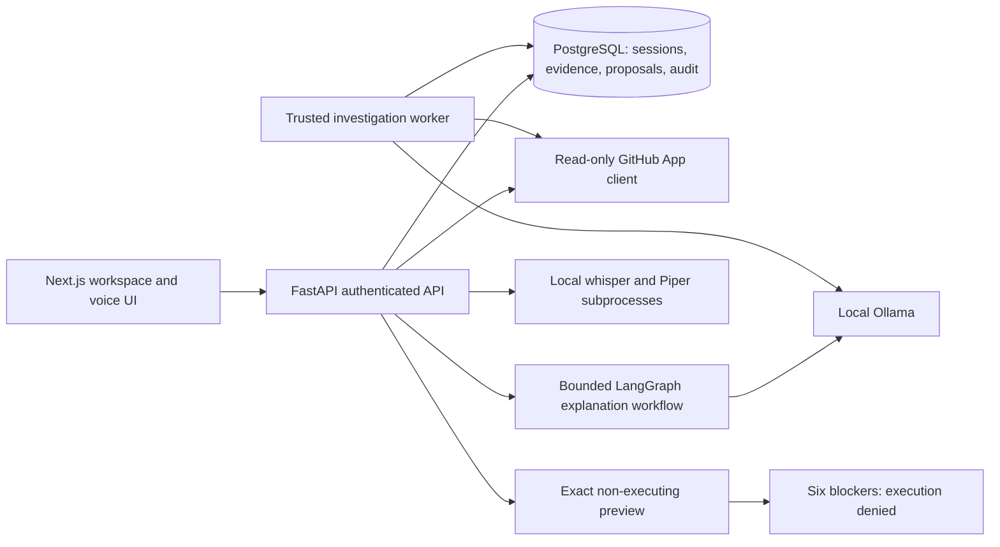

# CodeMate AI technical case study and interview notes

## Problem and solution

Developers move between failed CI logs, repository source and possible corrections.
CodeMate brings these into a local-first review workspace with a typed/voice
interface. It reads authorized GitHub data, retrieves pinned evidence and produces
local AI explanations or proposed patches. People retain control of review decisions.
It does not apply repository changes, execute sandbox tests or deploy anything.

## Architecture walkthrough

The trusted investigation worker processes analysis jobs, not untrusted repository
code. No sandbox execution worker/launcher exists. Preview manifests and hashes are
preparation records, not proof that a patch was materialized or validated.

## Decisions, tradeoffs and lessons

Use PostgreSQL ownership checks, transactions and row/advisory locks for durable
sessions and reviewed records. Argon2id protects passwords. Access JWTs remain in
memory; refresh tokens use scoped HttpOnly Strict cookies, hashed database records,
rotation and CSRF protection. Roles and active status are read from the database.
Already issued stateless access tokens retain their lifetime after logout.

A GitHub App with selected installation access limits exposure. Tokens are encrypted
on the backend; redirects/state/PKCE and per-request authorization protect access.
No contents-write, Actions-write, commit or pull-request creation is available.
Bounded clients handle upstream deadlines, errors, redaction and pagination.

LangGraph separates evidence retrieval, structured model output and validation.
Citations are checked against retrieved evidence; this establishes provenance, not
truth of an AI hypothesis. Invalid model output is rejected. Prompt content cannot
grant tools or permissions. Local inference reduces hosted-provider exposure but
introduces model availability, hardware latency and output-quality limits.

The main challenge was separating explanation, proposal, review approval and
execution approval. Exact commit/patch/binding hashes and audit history preserve
that distinction. Six unmet runtime requirements prevent unsafe feature completion.
The lesson is to keep an unavailable feature visibly unavailable, rather than
turn an unverified isolation prototype into a production claim.

Security maintenance also needs current evidence. A historical clean dependency
audit did not remain clean. The Zod 4 migration uses an exact patched dependency
alongside decoded-byte, JSON-shape and schema bounds. Dependency patches do not
replace resource limits or negative tests. Measured local latency is reported with
sample counts and fixture scope; no unsupported speedup claim is made.

## Thirty-second explanation

CodeMate AI is a local-first developer assistant for investigating GitHub Actions
failures and reviewing evidence-grounded explanations and patch proposals. I built
an authenticated Next.js/FastAPI workspace with PostgreSQL history, read-only GitHub
integration, local Ollama/LangGraph analysis and optional voice navigation. People
review exact diffs, while sandbox execution stays blocked until independent
isolation and worker security requirements are met.

## Two-minute technical explanation

The browser keeps access tokens in memory and restores sessions with rotating
HttpOnly refresh cookies and CSRF protection. FastAPI checks ownership and roles
for every protected resource. The GitHub App reads only authorized installations;
its tokens never reach the browser. An investigation worker retrieves bounded,
redacted workflow evidence, and LangGraph requests structured output from local
Ollama. Backend citation validation rejects unsupported references.

For source automation, the server pins a commit, validates a small file allowlist
and constructs the diff itself from validated replacements. Approval binds the
exact repository, source and patch hashes. A separate preview records the intended
manifest and validation profile, but no file is applied or command executed.
Six admission blockers stay visible and confirmation returns SANDBOX_UNVERIFIED.

Production-minded controls include upload/dependency limits, sanitized correlated
JSON logs, protected aggregate metrics and database readiness. Acceptance separates
controlled browser fixtures from real inference and manual hardware tests. It is
a local portfolio demonstration with documented limits, not certified public
production infrastructure or an autonomous repair service.

## Interview prompts

- Authentication/authorization: explain rotation, CSRF, RBAC, ownership and logout
  access-token limitations; do not claim JWT logout revokes every issued token.
- Ollama/LangGraph: describe finite evidence/model stages, deadlines and validated
  structured citations, and why a valid citation does not prove model correctness.
- GitHub: explain selected installation reads, encrypted backend tokens and safe
  revoked-access handling without adding write permissions.
- Patch review: explain backend-generated diffs, exact hashes, idempotent requests,
  expiry, human decisions and audit persistence. Review approval is not execution.
- Threat model: discuss prompt injection, source secrets, cross-user access,
  untrusted responses and incomplete hostile-code isolation/provenance.
- Challenges: resource bounds, stale responses, concurrent refresh, honest failures,
  accessibility and fixture cleanup. Use actual report results for test counts.

## Resume bullets

- Built a local-first Next.js/FastAPI developer assistant integrating a read-only
  GitHub App, PostgreSQL-backed history and evidence-grounded Ollama/LangGraph analysis.
- Implemented reviewed patch proposals with pinned source, exact diff/hash binding,
  durable audit records and fail-closed execution admission with six explicit blockers.
- Added protected operational telemetry, bounded API validation and deterministic
  regression/browser acceptance; documented live-service and deployment limitations.

## Limitations and future work

No public deployment, customer adoption, performance percentage gain or production
usage is claimed. Real-model quality varies. Physical audio requires separate
consented testing. Future work includes independently approved isolation/image
provenance, restricted worker/launcher and durable recovery, public TLS/backup and
monitoring operations, strict nonce CSP and formal accessibility/security review.
These are future items, not a new implemented milestone. Current verification
counts, exact security findings and release recommendation live in
MILESTONE_12_VERIFICATION.md.
